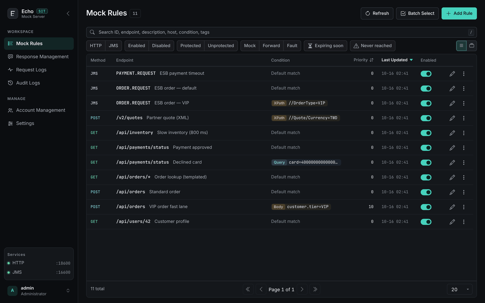
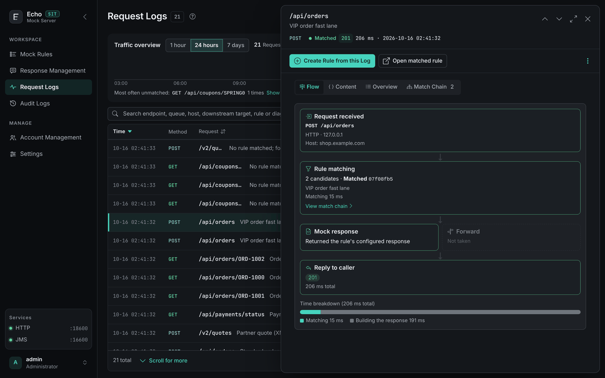
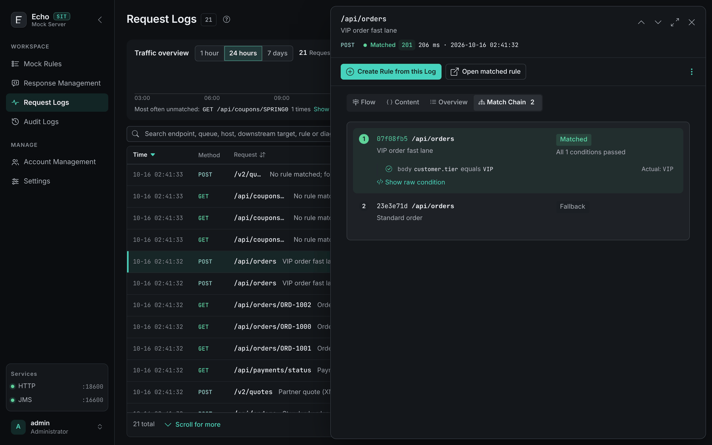
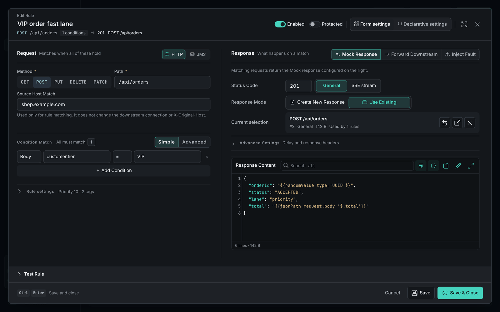
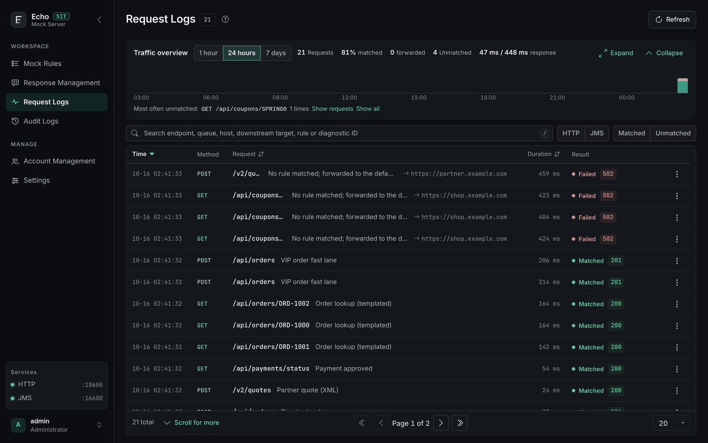
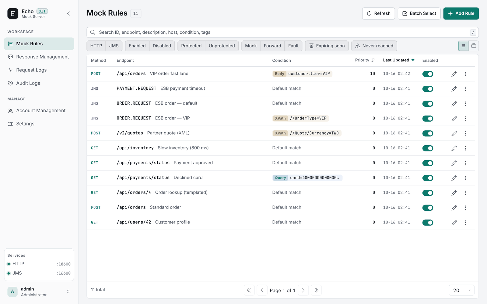

# Echo Mock Server

**Mock HTTP APIs and JMS queues from one self-hosted JAR, with a web console that shows why each request matched.**

[](https://github.com/boloagegit/echo-mock-server/actions/workflows/ci.yml)
[](https://github.com/boloagegit/echo-mock-server/releases)


[](LICENSE)

**English** · [繁體中文](README_zh-TW.md)



Echo stands in for the services your application talks to during development and testing. It answers HTTP calls and JMS messages with responses you define, and it forwards anything it doesn't recognise to the real system. Your team manages the rules in a browser. Echo runs as a single `java -jar` process with an embedded database and message broker, and needs nothing from the internet.

## Why Echo

- **HTTP and JMS in one place.** REST mocks and Artemis queue mocks share the same rules, templates and console. Unmatched JMS messages can be forwarded to TIBCO EMS or an Artemis ESB.
- **See why a request matched.** Every logged request shows its processing flow and the full match chain: which rules were candidates, and which condition passed or failed.
- **Built for teams.** It has logins (built-in accounts or LDAP) with admin and user roles, an audit trail, tags for bulk enable and disable, and rule protection and retention. Several instances can share one database.
- **Fits a locked-down network.** Ship one JAR, start it with `java -jar`, and keep the data in SQLite. The UI assets are bundled through WebJars, so no CDN is needed.
- **Measured, not guessed.** The benchmarks against WireMock are published with their method and scripts, and they show where WireMock is faster too. See [Performance](#performance).

## Quick start

Requires Java 17 or later.

```bash
# Download echo-server-<version>.jar from the Releases page, then:
java -jar echo-server-<version>.jar
```

Or build from source:

```bash
./gradlew bootJar
java -jar build/libs/echo-server-*.jar
```

Open <http://localhost:8080> and sign in with **admin / admin**. Change this password before you share the server. Data is stored in `./data/mockdb.sqlite`.

> Docker, external databases (PostgreSQL, MySQL, MariaDB, SQL Server, Oracle), Windows and multi-instance setups are covered in the [installation guide](docs/install.md).

### Your first mock in one minute

Create a rule. You can do this in the console, or through the REST API as shown here:

```bash
curl -u admin:admin -X POST http://localhost:8080/api/admin/rules \
  -H 'Content-Type: application/json' -H 'Accept: application/json' \
  -d '{
    "protocol": "HTTP",
    "targetHost": "api.example.com",
    "matchKey": "/users/1",
    "method": "GET",
    "status": 200,
    "responseBody": "{\"id\": 1, \"name\": \"Alice\"}"
  }'
```

Call it through `/mock`, and name the real host in `X-Original-Host`:

```bash
curl http://localhost:8080/mock/users/1 -H 'X-Original-Host: api.example.com'
# {"id": 1, "name": "Alice"}
```

To send traffic to Echo without changing your application code, point the client's base URL at Echo, or use an Nginx proxy that sets the header ([usage](docs/install.md#usage)). Requests that match no rule are forwarded to the original host.

Rules can also match on body, query and header conditions, and they can return templated responses:

```json
{
  "protocol": "HTTP",
  "targetHost": "api.example.com",
  "matchKey": "/orders",
  "method": "POST",
  "priority": 10,
  "bodyCondition": "customer.tier=VIP",
  "status": 201,
  "responseBody": "{\"orderId\": \"{{randomValue type='UUID'}}\", \"total\": \"{{jsonPath request.body '$.total'}}\"}"
}
```

## Features

**Matching**
- Conditions on JSON and XML bodies (JSONPath and XPath), query parameters and headers. Advanced expressions use `matchSpec`.
- Priorities, wildcard paths and a built-in rule tester.
- Optional stateful scenarios for multi-step flows, in the style of WireMock.

**Responses**
- Handlebars templates with conditions, loops, JSONPath and XPath, and Faker data. The same templates work for HTTP and JMS.
- Fixed or random delays, fault injection (connection reset or empty response) and Server-Sent Events streams.
- Shared responses that several rules can use.

**Protocols**
- HTTP mocking with proxy fallback to the original host.
- An embedded Artemis broker for JMS. Echo can also listen on a shared external broker, and it can forward unmatched messages to TIBCO EMS or Artemis.

**Console**
- Dark and light themes, and a responsive layout.
- Request logs with traffic charts, a processing-flow view and the match chain.
- Environment labels and accent colours to tell SIT and UAT apart, plus English and Traditional Chinese UI.

**Operations**
- Built-in accounts or LDAP, admin and user roles, remember-me, and an audit trail.
- Tags, batch enable and disable, rule protection, retention and extension, and orphan-response cleanup.
- Scheduled SQLite backups, multi-instance cache sync and resource monitoring.
- Optional OpenAPI and Swagger import, Excel import, and JSON export and import. These are off by default.

## Screenshots

| Request flow | Match chain |
|---|---|
|  |  |
| **Rule editor** | **Request logs** |
|  |  |

There is also a light theme:



## Performance

Measured on one 4-vCPU Linux machine with 2,004 rules loaded on both servers (Echo vs WireMock 3.13.2, wrk, 2026-10-14). The table shows requests per second:

| Scenario | Echo, logs kept | WireMock, journal 10k | Echo, no log | WireMock, no journal |
|----------|---------:|---------:|---------:|---------:|
| Fixed JSON, 8 connections | 8,191 | 1,515 | 9,920 | 38,023 |
| Response template | 6,760 | 1,490 | 8,544 | 23,629 |
| XML ~1.5 KB + XPath | 7,401 | 2,147 | 9,951 | 14,540 |
| XML ~100 KB + XPath | 4,097 | 911 | 6,262 | 1,941 |
| One of 2,000 path rules | 6,419 | 417 | 9,195 | 3,204 |

- **Request history on.** When both servers keep the last 10,000 requests, Echo is 3.5 to 15 times faster.
- **Recording off.** With recording off on both servers, WireMock is 1.5 to 4.4 times faster on simple requests. Echo is 1.8 to 3.2 times faster on large XML, and 2.9 times faster when matching across 2,000 rules.
- **Startup.** WireMock starts in about 1 second; Echo takes about 12 seconds.

These numbers apply only to this workload. The full method, bottlenecks and rerun scripts are in [docs/performance.md](docs/performance.md) (in Traditional Chinese).

## Documentation

| Guide | Covers |
|-------|--------|
| [Installation and deployment](docs/install.md) | JAR, Docker, database profiles, H2 migration, multi-instance, Nginx |
| [Configuration and authentication](docs/configuration.md) | `application.yml`, LDAP, built-in accounts, roles |
| [Rules and responses](docs/rules.md) | Priority, conditions, tags, scenarios, templates |
| [JMS](docs/jms.md) | Embedded broker, ESB forwarding, shared-broker setup |
| [REST API](docs/api.md) | The main admin endpoints |
| [All documentation](docs/README.md) | SSE, monitoring, diagnostics, recovery and more |

## Contributing

Bug reports, ideas and pull requests are welcome. See [CONTRIBUTING.md](CONTRIBUTING.md) for the build and test steps, and [CHANGELOG.md](CHANGELOG.md) for what changed. Report security issues privately as described in [SECURITY.md](SECURITY.md).

Echo is built with Spring Boot 3.5, Undertow, Caffeine, embedded Artemis, Handlebars, Vue 3 and Bootstrap 5.

## License

[MIT](LICENSE)
