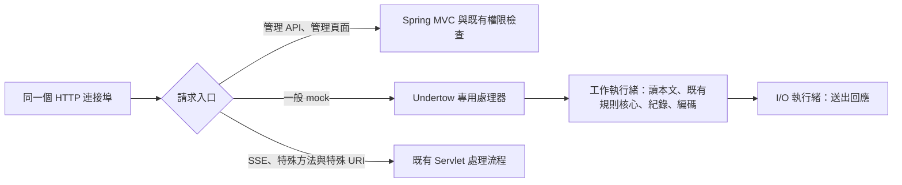

# Echo 原生 HTTP 入口實驗：與 WireMock 的效能比較

後續的資源上限、失敗處理與重新量測見 [2026-10-16 補強報告](performance-hardening-2026-10-16.md)。本文保留加上這些保護前的歷史數字。現行一般發行檔已納入可設定啟用的 adapter；請依 [HTTP 加速路徑](native-http.md) 設定，舊的實驗建置參數已移除。

日期：2026-10-15。基底版本：`8ee8dcbed814a3dfb5fab1f6b791556d6c81cea7`。

## 選擇的方向

保留 Undertow，讓一般 mock 請求直接進入既有 `HttpMockPipeline`。管理介面與管理 API 繼續走 Spring MVC。讀取本文、規則匹配、模板、紀錄及回應編碼放在工作執行緒；完成後交回 I/O 執行緒送出。



每筆請求仍使用資料庫載入的規則快照、條件匹配、模板、轉發及 ServeEvent 流程。修改規則、回應內容與刪除規則仍透過原管理 API 生效。

這份實作是**可建置、可重跑的架構實驗**。程式位於 `src/httpExperiment/`，只有 `-PhttpTransportExperiment` 才納入建置；一般發行版不包含它。兩條路徑目前仍共用 JVM、heap 與 Undertow 工作池，尚未提供資源隔離。

## 為什麼選這個方案

先以同一套 Echo 核心實跑伺服器與入口配置。以下是第一階段單輪篩選，固定 JSON、8 連線，不能取代後面的正式比較：

| 方案 | 每秒請求數 | 解讀 |
|---|---:|---|
| Undertow + 原 MVC 入口 | 15,568 | 原流程對照 |
| Tomcat + 原 MVC 入口 | 24,504 | 有改善，仍不足以解決整段入口成本 |
| Jetty + 原 MVC 入口 | 18,906 | 此次預設配置沒有明顯優勢 |
| Undertow 原生入口、工作執行緒回覆 | 47,466 | 縮短入口路徑有明顯效果 |
| Undertow 原生入口、運算後交回 I/O 回覆 | 63,285 | 選來進一步驗證的安排 |
| 原生入口、全部在 I/O 執行緒執行 | 127,058 | **僅為上限探測，不採用**；慢查詢與運算會阻塞 I/O |

篩選原型尚未包含完整診斷、HTTP 指標及非同步生命週期，因此其數字只用來選方向。Jetty 在多容器實驗 classpath 中需要明確套用 Jetty 的 WebSocket customizer；未成功啟動的那一次保留在原始資料中，不算效能結果。

完整原型第一次使用非同步本文收集器時，100 KB XML 出現明顯退步。改為工作執行緒讀取本文後，篩選量測由約 4,566 提升到 18,555 requests/s。沒有本文的請求另行直接進入核心，避免 `InputStream.readAllBytes()` 的 8 KiB 暫存配置。回應 UTF-8 編碼與內容類型判定也在工作執行緒完成。

## 正式比較方法

- Java 21.0.12.1；兩者皆 `-Xms1g -Xmx1g -XX:+UseG1GC`。建置與回歸測試使用 JDK 17.0.20.1。
- 同一個 Linux 容器，4 核 CPU 配額、16 GiB 記憶體上限。最終量測將伺服器、用戶端與本機下游一起固定在 CPU 0–3，避免「可排程 5 核、配額只有 4 核」帶來額外的週期性限速。
- Echo：原生入口 `native-handoff-stream`，2 條 I/O、8 條工作執行緒。這是此次 4 核環境篩選出的配置，不是各種硬體與負載的通用預設。
- WireMock standalone 3.13.2：分別測量 32 與 128 條 container threads，各兩輪；開啟 async response、32 條 async threads。提高 container threads 是為了避免慢轉發被較小的工作池限制。
- 每個程序使用全新暫存目錄與資料庫。正式矩陣兩者各 2,010 條規則；請求紀錄皆停用，WireMock 同時關閉 request journal 與 request logging。
- Echo 的交易診斷及基本 HTTP 計時仍啟用。原型計時不代表已完整實作 Servlet observation／分散式 tracing 的所有語意。
- `wrk` 4 threads，先暖機，再對每個情境預熱 3 秒、測量 10 秒。主比較順序為 Echo → WireMock(128) → WireMock(128) → Echo，之後以相同 CPU 限制補測 WireMock(32) 兩輪。
- 轉發下游是同機 Node fixture，快回覆或等待 50 ms；它也共用上述 4 核。這不是外部網路、TLS 或真實金融下游的量測。
- 每輪壓測前後檢查回應本文、狀態、大回應完整長度、延遲時間及下游 503 傳遞。負載中檢查 HTTP 與 socket 錯誤。延遲／轉發後另檢查 Echo pool 與緩衝資源歸零。
- 矩陣的 P99 是在各自最大輸出負載下取得；額外用 `wrk2` 固定每秒 20,000／40,000 請求，比較相同到達率下的延遲。固定到達率測試兩者皆 2,004 條規則。

## 最終數字

以下是各配置兩輪的算術平均。吞吐與 P99 各自挑選 WireMock 32／128 工作執行緒中較好的平均值，兩欄可能來自不同配置；這讓對手採用較有利的結果。P99 欄是每輪 P99 的平均，**不是合併所有請求後重新計算的 P99**。

| 情境 | Echo req/s | WireMock 較高 req/s | 吞吐倍數 | Echo P99 ms | WireMock 較低 P99 ms |
|---|---:|---:|---:|---:|---:|
| 固定 JSON，8 連線 | 56,247 | 42,471 | 1.32× | 1.06 | 4.25 |
| 固定 JSON，64 連線 | 88,322 | 58,682 | 1.51× | 3.59 | 10.38 |
| 固定 JSON，256 連線 | 105,861 | 63,510 | 1.67× | 7.58 | 18.35 |
| 模板，8 連線 | 53,760 | 23,712 | 2.27× | 1.39 | 5.07 |
| 1.5 KB XML，8 連線 | 34,082 | 15,524 | 2.20× | 2.06 | 5.30 |
| 100 KB XML／條件在前，8 連線 | 18,619 | 2,260 | 8.24× | 3.66 | 14.24 |
| 100 KB XML／條件在末，8 連線 | 4,532 | 1,203 | 3.77× | 4.86 | 21.61 |
| 2,000 個路徑隨機查找，8 連線 | 53,687 | 4,430 | 12.12× | 0.89 | 10.32 |
| 256 KiB 回應，64 連線 | 15,807 | 2,274 | 6.95× | 11.74 | 82.90 |
| 快速轉發，64 連線 | 14,152 | 1,861 | 7.60× | 14.41 | 92.56 |
| 下游等待 50 ms，64 連線 | 1,240 | 1,163 | 1.07× | 57.42 | 70.81 |
| Mock 延遲 50 ms，64 連線 | 1,253 | 1,211 | 1.03× | 52.62 | 61.39 |
| 混合負載後固定 JSON，8 連線 | 54,134 | 40,909 | 1.32× | 1.29 | 4.98 |

六個完整程序、78 個負載階段的 HTTP／socket 錯誤皆為 0。另四個固定到達率階段也沒有 HTTP／socket 錯誤。50 ms 等待情境只有小幅差距，不當作數倍性能優勢。


## 相同請求量的延遲

WireMock 使用 32 條 container threads。各速率測量 30 秒，以下為 `wrk2` corrected latency；這一項每產品每速率只有一次測量，尚未建立長時間尾端延遲的信賴區間。

| 目標 req/s | Echo 實際 req/s | WireMock 實際 req/s | Echo P99 / P99.9 ms | WireMock P99 / P99.9 ms |
|---|---:|---:|---:|---:|
| 20,000 | 19,815 | 19,815 | 4.02 / 17.06 | 5.26 / 27.31 |
| 40,000 | 39,627 | 39,948 | 8.27 / 25.15 | 10.17 / 19.31 |

Echo 的 P99 在兩個速率都較低，但 40k/s 的 P99.9 較高（25.15 vs 19.31 ms）。因此不能宣稱所有延遲指標都勝出；極端尾端抖動仍需改善。工具實際完成速率如表列，並非假設剛好等於目標速率。

## 穩定性與 CPU 證據

### 開啟紀錄的尖峰與恢復

保留正常的 database／非同步紀錄預設，先跑 8 連線 20 秒，升至 256 連線 60 秒，降回 8 連線 20 秒，停流量 10 秒後再跑 8 連線 20 秒；各階段另有暖機，最後停流量 20 秒。

| 階段 | req/s | P99 ms |
|---|---:|---:|
| 壓力前，8 連線 | 32,953 | 4.65 |
| 尖峰，256 連線 | 71,765 | 13.98 |
| 降載後，8 連線 | 37,160 | 3.58 |
| 停流量後恢復，8 連線 | 37,811 | 3.30 |

四階段 HTTP／socket 錯誤皆為 0。LogAgent 總佇列在尖峰後為 63,367 筆，最後 queue size、queue bytes、in-flight bytes 均歸零。Full GC 後 heap 由壓力前 59.9 MiB 回到 59.7 MiB，這是短時間恢復證據，不能推論長期沒有洩漏。

**紀錄保存仍有缺口：** `RequestLogHandoff` 警告合計 **1,383,352 筆**在暫存區被捨棄；另有 **6,343,968 筆**依最新 10,000 筆的保留策略被略過。兩者合計等於 agents API 的 `droppedCount=7,727,320`。這些累計包含暖機，不能除以僅正式測量的請求數計算丟失率，也不能把保留策略的略過全稱為意外資料遺失。預設模式優先回應、不等紀錄寫入，成功回應數不代表每筆紀錄都被保存；本次沒有測 strict durable 模式的效能或故障復原。

### CPU 取樣

另一次固定 JSON 的 JFR 取樣共有 1,471 個 execution samples。先前原 MVC 入口在 `HttpReadListener.handleEvent:128` 自旋位置取到 2,248 / 8,413 個樣本；本次該行為 **0**，該方法只在非自旋的第 137 行取到 4 個樣本。新取樣也未再出現 MVC handler lookup／Spring Security 的請求堆疊。這支持縮短入口、交回 I/O 完成回應的方向，不能把取樣占比直接當作 wall-clock 時間比例。

仍可看到 Spring bean 查找、AOP、規則核心與物件配置的改善空間。這次取樣有 34 次 GC，暫停合計 134.31 ms，最長 28.55 ms。它與固定到達率測試是不同次執行，不能直接斷言前面的 P99.9 尖峰由這次 GC 造成；減少配置與驗證 GC 尾端延遲仍有必要。

### 尚未勝出的記憶體與啟動成本

| 指標 | Echo 原型 | WireMock 兩種工作池配置 |
|---|---:|---:|
| Full GC 後 heap | 約 60.2 MiB | 約 15.4–19.9 MiB |
| Metaspace | 約 121.4 MiB | 約 29.2 MiB |
| 程序結束前 RSS | 約 1,296–1,314 MiB | 約 1,052–1,101 MiB |
| 全新資料目錄到 ready | 約 11.4–12.3 秒 | 約 0.9–1.2 秒 |

RSS 包含 JVM 保留與已提交記憶體，不等同存活物件。啟動時間包含首次建表等初始化，不代表一般重新啟動。Echo 仍載入 Spring 管理功能、JPA、JMS 等，原生入口沒有移除這些固定成本。若目標包括記憶體與啟動速度，需要讓 HTTP 執行引擎可獨立啟動，按需載入管理與 JMS 能力，並另行量測。


最後版本通過 111 項測試，包括既有 HTTP、SSE 轉發、請求紀錄、權限與 controller 回歸，以及 6 項實際 HTTP 入口檢查：原生路徑命中計數、中文／UTF-16 本文、狀態與自訂 header、規則修改與刪除立即生效、延遲與逾時、HEAD／SSE 回退、管理 API 與路徑穿越的權限邊界。測試清單與原始計數在 `regression-final.json`。

## 正式化仍須完成的工作

目前的證據足以選定入口架構：本矩陣的吞吐及最大負載 P99 都領先，但固定到達率的極端尾端延遲、記憶體、啟動及完整紀錄保存尚未全面勝出。正式切換前還需要：

1. **慢用戶端與過載保護**：為待送出的回應 bytes、排隊請求及慢速寫入設置明確總量與時間上限；驗證大量慢上傳／慢下載時，管理 API 和一般請求仍能前進。現在的工作池與本文讀取方式尚不足以證明這件事。
2. **HTTP 行為完整對照**：補齊 TLS、HTTP/2、超大／不完整本文、charset／content negotiation、連線中斷及 observation/tracing 的差異檢查。SSE、HEAD、OPTIONS、表單、multipart、encoded URI、Forwarded headers 等目前沿用既有 Servlet 流程。
3. **紀錄可靠性與長時間運行**：驗證 strict durable logging 在磁碟故障／復原時的行為，並做長時間混合負載與規則更新測試。短時間壓力恢復不能推論 24 小時不漏記錄或沒有記憶體問題。

故意等待 50 ms 的情境，吞吐量會受等待時間與連線數限制；這類情境應以時間準確、資源回收及尾端延遲作為目標。未量測的 JSONPath、複雜 XPath、TLS、SSE 吞吐、JMS 或不同硬體，不延伸宣稱勝出。

## 重跑與檔案

```bash
./gradlew bootJar -PhttpTransportExperiment -PreleaseVersion=0.0.0-SNAPSHOT

ECHO_BENCH_WORKERS=8 ECHO_BENCH_IO=2 WM_BENCH_WORKERS=128 \
PERF_MODE=matrix taskset -c 0-3 bash \
  scripts/bench/2026-10-15/transport-experiment/matrix.sh \
  build/http-experiment/echo-server-0.0.0-SNAPSHOT-http-experiment.jar \
  /absolute/path/wiremock-standalone-3.13.2.jar \
  /tmp/echo-native-new-results 2
```

需要 Java、`jcmd`、`wrk`、`curl`、Python 3、Node；固定到達率測試另需 `wrk2`。CPU 編號需依實際可用範圍調整。結果目錄必須是新的，腳本會重建每輪目錄，並使用獨立暫存資料庫；18080、18081 連接埠需空閒。

補測 WireMock 可加 `WM_ONLY=1 WM_BENCH_WORKERS=32`，兩輪使用同一個 matrix 模式。相同腳本可使用 `PERF_MODE=latency`、`recovery`、`profile`；後兩者只跑 Echo，`recovery` 使用正常的開啟紀錄設定。腳本位於 [scripts/bench/2026-10-15/transport-experiment](../scripts/bench/2026-10-15/transport-experiment/)；原始資料未保留在 repository，數字以本文為準。`wrk2` 來源為 [giltene/wrk2](https://github.com/giltene/wrk2)，固定 commit `44a94c17d8e6a0bac8559b53da76848e430cb7a7`。

一般 `./gradlew bootJar` 已重建並檢查：不包含實驗 class，依賴集合與原版完全相同，未加入 Jetty server／Tomcat core。原本 Undertow 套件共用的 Tomcat EL 仍保留。實驗 JAR 輸出到 `build/http-experiment/`，與正常 `build/libs/` 分開。
